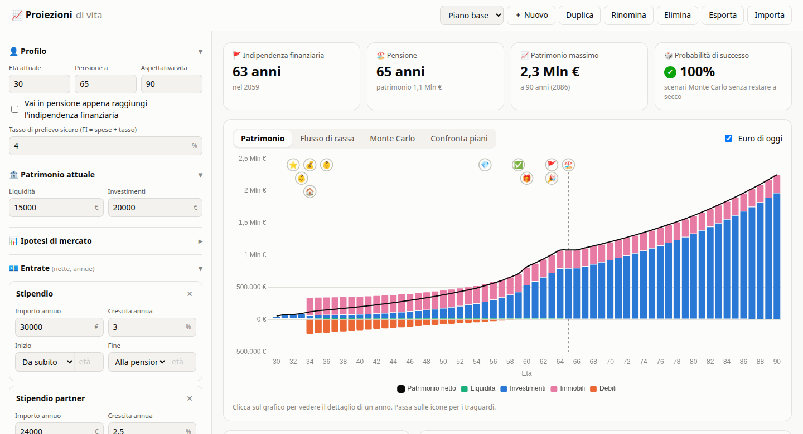
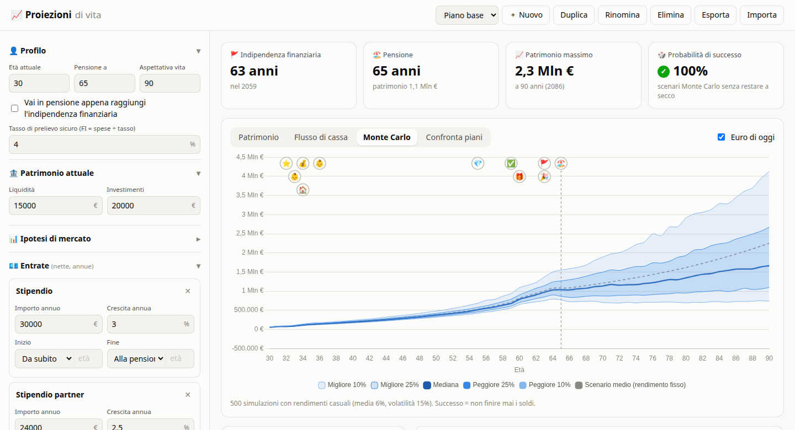

# 📈 Proiezioni di vita

Un simulatore semplice del tuo futuro finanziario: inserisci entrate, spese ed eventi di vita (figli, acquisto casa, matrimonio, eredità…) e vedi come potrebbe evolvere il tuo patrimonio anno per anno, fino alla fine della vita.

Ispirato a [ProjectionLab](https://projectionlab.com/), ma molto più semplice. Non è affiliato a ProjectionLab.

> 🤖 **Progetto realizzato con l'AI.** Il codice di questo repository è stato scritto con [Claude Code](https://claude.com/claude-code) (Anthropic), partendo dalle mie richieste e dalla mia revisione.



## Funzionalità

- **Profilo e ipotesi**: età attuale, età della pensione, aspettativa di vita, inflazione, rendimento atteso e volatilità degli investimenti.
- **Entrate e spese** annue, ognuna con la sua crescita e il suo periodo (da subito, dalla pensione o da una certa età, fino alla pensione, per sempre o fino a una certa età).
- **Eventi di vita**:
  - 👶 figli, con un costo annuo per un certo numero di anni;
  - 🏠 acquisto della casa, con anticipo, mutuo (rata calcolata), rivalutazione e costi annui;
  - ⭐ spese o entrate una tantum.
- **Traguardi calcolati in automatico**: indipendenza finanziaria, pensione, primi 100k, primo milione, mutuo estinto, "soldi finiti".
- **Quattro grafici**: patrimonio (liquidità, investimenti, immobili, debiti), flusso di cassa, Monte Carlo (500 simulazioni con rendimenti casuali e probabilità di successo) e confronto tra piani.
- **Euro di oggi**: tutti i valori si possono vedere al netto dell'inflazione.
- **Dettaglio anno per anno**: clicca sul grafico per vedere composizione del patrimonio, entrate e uscite di quell'anno. C'è anche una tabella completa.
- **Più piani**: crea, duplica e confronta scenari diversi ("e se avessimo due figli?"). Puoi esportarli e importarli in JSON.

Tutti i dati restano nel tuo browser (`localStorage`): niente account e niente server.



## Usarlo in locale

Ti servono [Node.js](https://nodejs.org/) 20.19 o successivo (consigliato 22+) e Git.

```bash
git clone https://github.com/<tuo-utente>/proiezioni-di-vita.git
cd proiezioni-di-vita
npm install
npm run dev
```

Poi apri l'indirizzo mostrato nel terminale (di solito http://localhost:5173).

Per creare una versione statica da pubblicare (per esempio su GitHub Pages o Netlify):

```bash
npm run build     # genera la cartella dist/
npm run preview   # la prova in locale
```

## Come funziona il calcolo

La simulazione avanza un anno alla volta, dall'età attuale all'aspettativa di vita:

1. gli investimenti crescono del rendimento atteso, la liquidità del suo interesse;
2. si sommano le entrate e le spese attive in quell'anno (inclusi figli, mutuo ed eventi);
3. il **risparmio** riempie prima il fondo di emergenza, poi viene investito;
4. un **deficit** si copre prima con la liquidità, poi vendendo investimenti. Se non bastano, il piano segnala "soldi finiti";
5. l'**indipendenza finanziaria** è raggiunta quando liquidità + investimenti ≥ spese annue ÷ tasso di prelievo sicuro (4% di default, cioè 25 volte le spese).

Il codice è in tre file:

| File | Contenuto |
|---|---|
| [`src/sim.js`](src/sim.js) | motore di simulazione e Monte Carlo |
| [`src/main.js`](src/main.js) | interfaccia, grafici (Chart.js) e gestione dei piani |
| [`src/defaults.js`](src/defaults.js) | piano di esempio e valori iniziali |

## Limiti

- Gli importi delle entrate vanno inseriti **già al netto delle tasse**: l'app non calcola IRPEF né tasse sui rendimenti.
- C'è un solo tipo di investimento, con un rendimento medio e una volatilità.
- È uno strumento per ragionare su scenari, **non una consulenza finanziaria**.

## Tecnologie

[Vite](https://vite.dev/), JavaScript senza framework e [Chart.js](https://www.chartjs.org/).

## Licenza

Distribuito con licenza [MIT](LICENSE): puoi usarlo, modificarlo e ridistribuirlo liberamente, mantenendo l'avviso di copyright.
